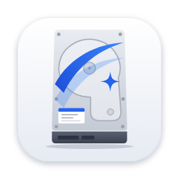
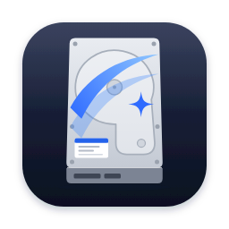

# OpenCleaner brand

<p>
  
  
</p>

A silver hard disk with a blue sweep: one swipe and the drive is clean.

## Files

| Path | What |
|---|---|
| `svg/opencleaner-icon-light.svg` | Master app icon (default everywhere) |
| `svg/opencleaner-icon-dark.svg` | Dark variant (dark themes, promo art) |
| `svg/opencleaner-mark-light.svg`, `-dark.svg` | Sweep mark without the drive, for 48 px and below |
| `svg/opencleaner-icon-foreground.svg` | Android adaptive-icon foreground (drive only, safe-zone framed) |
| `png/` | Rendered light/dark PNGs, 1024 down to 16 px |
| `build_icons.py` | Regenerates every app icon in the repo from the SVGs |

**Size rule:** drive icon at 64 px and up, sweep mark at 48 px and below (the drive's screws and label turn to noise when small).

## Where the icons live in each app

| App | File(s) | Wired up by |
|---|---|---|
| Linux | `linux-cachyos/icon.svg` | |
| macOS | `macos/Resources/AppIcon.iconset/`, `macos/Resources/icon.svg` | `build_app.sh` (`iconutil` → `AppIcon.icns`) |
| Windows WinForms | `windows/icon.ico` | `build.bat` (`/win32icon`) |
| Windows WinUI 3 | `windows-winui/icon.ico` | `OpenCleaner.csproj` (`ApplicationIcon`) + `AppWindow.SetIcon` |
| Android | `mipmap-anydpi-v26/ic_launcher.xml` (adaptive: `drawable/ic_launcher_background.xml` + `mipmap-*/ic_launcher_foreground.png`), legacy `mipmap-*/ic_launcher.png` | `AndroidManifest.xml` |

To change the icon: edit the SVGs, then

```bash
pip install playwright pillow && python -m playwright install chromium
python3 docs/brand/build_icons.py
```

## Name, type and color

- Name: always one word, **OpenCleaner**. Never "Open Cleaner" or "OPENCLEANER".
- Font: **Ubuntu** (Google Fonts). Medium 500 for the name and headings, Regular 400 for body.

| Color | Hex | Use |
|---|---|---|
| Trust Blue | `#2563EB` | Primary, buttons, links |
| Sky | `#3A86FF` | Sweep highlight |
| Deep | `#1D4ED8` | Sweep shade, pressed states |
| Silver | `#E9ECF1` → `#C4CAD4` | The drive |
| Graphite | `#3A4150` | Drive edge, dark details |
| Ink | `#0B1020` | Text, dark backgrounds |
| Slate | `#5B6478` | Secondary text |
| Cloud | `#F2F4F8` | Light backgrounds |

Don't recolor the drive or the sweep, stretch or rotate the icon, or add glows and outlines.
Keep clear space of 20% of the icon's width around it.
